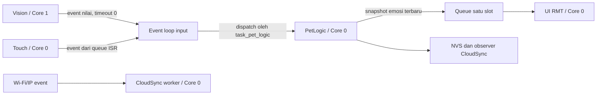

# Pely ESP-IDF entry point

[main.cpp](main.cpp) menghubungkan seluruh komponen dengan `extern "C" void app_main()`.
Target adalah **ESP32-S3-N16R8**, ESP-IDF **5.3–5.x**, flash 16 MB dan PSRAM octal 8 MB.
Root [CMakeLists.txt](../CMakeLists.txt), [sdkconfig.defaults](../sdkconfig.defaults), dan
[partitions.csv](../partitions.csv) menyediakan build firmware; aplikasi Python tetap tersedia.

## Task dan kepemilikan

| Task | Core | Stack (byte) | Prioritas | Tanggung jawab |
| --- | --- | --- | --- | --- |
| `task_vision_ai` | 1 | 8192 | 4 | Memiliki CameraHal/VisionAI, capture dan inferensi |
| `task_pet_logic` | 0 | 8192 | 4 | Pemilik state pet, dispatcher input dan observer NVS cloud |
| `task_ui` | 0 | 4096 | 5 | Pemilik LedMatrix, transisi/kedipan sekitar 30 FPS |
| `task_touch_sensor` | 0 | 4096 | 5 | Memiliki TouchSensor, tidur pada queue ISR ketika idle |
| `cloud_sync` | 0 | 6144 | 2 | Worker internal CloudSync untuk placeholder upload JSON |

Stack API FreeRTOS ESP-IDF dinyatakan dalam byte. Stack normal tetap di RAM internal;
framebuffer kamera, arena AI, dan workspace decoder memakai PSRAM sesuai komponennya.
`CONFIG_CAMERA_CORE1=y` juga memindahkan task internal driver kamera ke Core 1.



Loop pet dibuat dengan `task_name = nullptr`; **hanya `task_pet_logic`** menjalankan
`esp_event_loop_run()`. Handler vision/touch dan observer pet CloudSync karena itu
berjalan pada task state yang sama. Callback input tidak menjalankan RMT, inferensi,
atau audio playback. Wi-Fi menggunakan default event loop terpisah.

UI membaca queue satu-slot dengan timeout 0. Produsen memakai `xQueueOverwrite()`;
snapshot state terbaru menggantikan yang lama. Snapshot juga menyertakan reaksi
sementara, prioritas, dan waktu berakhir, sehingga update mood tidak menghilangkan
respons elusan. UI tetap melakukan tick meskipun tidak ada pesan baru. RMT refresh
tetap memerlukan waktu transmisi LED normal; UI tidak menunggu kamera/NVS/cloud.

## Startup dan input

`app_main()` menyiapkan NVS tanpa automatic erase, `esp_netif`, event loop, katalog,
mailbox, dan empat task aplikasi. Semua argumen task menunjuk runtime statis di RAM
internal yang tetap hidup setelah `app_main()` kembali. Vision/touch menunggu flag
pet siap; kegagalan inisialisasi storage melepas waiter dengan flag gagal dan
mengirim ekspresi error ke UI.

Vision memproses frame di Core 1 lalu mengirim struktur kecil berisi ID, confidence,
sequence, timestamp, dan status frame. Lease framebuffer dilepas sebelum posting;
tidak ada pointer pixel yang dikirim antar task. Frame kosong yang valid juga
dikirim untuk mereset kandidat; kesalahan capture/inferensi dibedakan dari background.
Posting memakai timeout 0. Jika antrean penuh, input dapat hilang dan dicatat;
sequence gap mereset konfirmasi agar frame yang terlewat tidak dihitung berurutan.

Konfirmasi default memerlukan **3 frame berurutan**, confidence >=70%, dan umur event
maksimum 1 detik. Setelah makanan benar/salah diterima, kartu yang sama hanya
ditanggapi sekali sampai tiga frame background atau kartu lain terlihat stabil.
Cooldown yang belum selesai dapat dicoba pada frame berikutnya. Frame usang/gagal
tidak melepaskan latch kartu yang sudah dikonsumsi.

Elusan menambah kasih sayang pada task pet dan menampilkan `HAPPY` selama 2,8 detik.
Makanan benar menampilkan `HAPPY`, makanan salah `ANGRY`, dan kondisi mati selalu
mengalahkan reaksi sementara. CloudSync menghapus save saat mati tetapi pet tetap
mati di RAM. Inferensi berhenti menunggu ketika pet mati dan dapat dilanjutkan
setelah pet baru dibuat. Speech intent saat ini dicatat ke log; audio belum menjadi
komponen firmware pada integrasi ini.

## Konfigurasi dan build

1. Aktifkan environment ESP-IDF 5.3 atau versi 5.x yang kompatibel.
2. Jalankan `idf.py set-target esp32s3`, lalu `idf.py menuconfig`.
3. Pada **Pely application**, isi GPIO OV5640, GPIO/layout WS2812, serta GPIO TTP223
   atau channel touch internal sesuai skematik. Nilai pin default -1 sengaja belum
   menunjuk hardware. Dua panel 8x8 dapat memakai canvas 16x8 dengan tile 8x8.
4. Isi **Food IDs in model channel order** sesuai urutan kelas training, tanpa
   background, serta indeks background, ukuran input, normalisasi, dan mode output.
   Contoh `apple,milk` hanya benar jika memang itulah urutan export model.
5. Sediakan `assets/model/fomo_model.h` berisi definisi lengkap
   `const unsigned char fomo_model_int8[]` dari export **ESP-DL `.espdl`** asli.
   CMake mengizinkan konfigurasi tanpa model, tetapi kompilasi firmware meminta file
   tersebut. Tidak ada bobot model pengganti dalam repositori.
6. Jalankan `idf.py build`, lalu `idf.py -p PORT flash monitor` pada perangkat.

[Kconfig.projbuild](Kconfig.projbuild) menyimpan pilihan aplikasi. Katalog
[food_catalog.json](../data/food_catalog.json) di-embed saat build dan di-parse sekali.
ID pada metadata model wajib ada pada katalog; hanya makanan yang didukung model
akan diminta pet. Urutan kelas tidak diambil otomatis dari urutan JSON. Batas loader
adalah 32 makanan dan 8 alias per makanan.

Jika CSV label kosong, pet memakai katalog lengkap tetapi task vision mencatat
bahwa metadata belum diisi dan berhenti. GPIO yang belum diisi juga menyebabkan
task hardware terkait melaporkan error dan berhenti; task lain tetap terpisah.
Isi konfigurasi sebelum memakai firmware pada hardware.

Wi-Fi default nonaktif agar permainan berjalan offline. Untuk mengaktifkan,
pilih opsi station lalu isi SSID/password di menuconfig. Reconnect dibatasi; save
lokal tidak menunggu internet. Kredensial tidak dicetak dan konfigurasi lokal
`sdkconfig` diabaikan Git. Firebase tetap placeholder seperti pada komponen
[cloud_sync](../components/cloud_sync/README.md).

Tabel partisi menyediakan NVS 64 KiB dan satu factory app 8 MiB; OTA/filesystem
belum dikonfigurasi. Defaults tidak menimpa `sdkconfig` yang sudah ada, sehingga
verifikasi PSRAM octal, flash 16 MB, affinity app_main Core 0, dan kamera Core 1
di menuconfig pada konfigurasi lama. Task berjalan sepanjang lifetime firmware;
shutdown dinamis perlu protokol stop/ack sebelum menghancurkan perangkat/queue.

## Verifikasi host

```text
python main/test/host/run_tests.py --cjson-dir PATH_TO_IDF/components/json/cJSON --compiler clang++
```

`IDF_PATH` dapat menggantikan `--cjson-dir`. Tes mengompilasi entry point asli dan
header komponen asli dengan endpoint hardware/RTOS tiruan serta cJSON asli. Ada
15 skenario pada konfigurasi offline, Wi-Fi tanpa assertions, dan touch internal:
placement task, kepemilikan state, dispatch asinkron, lease frame, konfirmasi,
deduplikasi kartu, mailbox UI, reaksi mati, label model, dan kegagalan startup.
Tes tidak mensimulasikan scheduler SMP atau menjalankan kernel ESP-DL.

Kconfig sudah diperiksa dengan parser Kconfig dan partisi diverifikasi memakai
generator ESP-IDF 5.3.3 untuk flash 16 MB. Build firmware dan uji hardware masih
memerlukan toolchain ESP-IDF serta model/pin asli.

Referensi: [manual event loop](https://docs.espressif.com/projects/esp-idf/en/v5.3.3/esp32s3/api-reference/system/esp_event.html),
[FreeRTOS IDF](https://docs.espressif.com/projects/esp-idf/en/v5.3.3/esp32s3/api-reference/system/freertos_idf.html).
